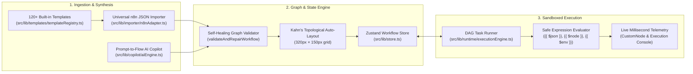

# Flow2Flow — Enterprise Open-Source AI Workflow Automation Platform

[](./LICENSE)
[](#enterprise-template-ecosystem)
[](#sandboxed-microservices-task-runner)

**Flow2Flow** is an enterprise-grade, open-source workflow automation platform designed to deliver complete feature parity with **n8n** while eliminating restrictive `'Sustainable Use'` fair-code licensing barriers. Distributed under the **100% permissive Apache 2.0 license**, Flow2Flow allows developers and enterprises to self-host, embed, white-label, modify, and resell workflows with zero vendor lock-in.

Combining a **Universal n8n Template Importer**, a **Prompt-to-Flow AI Copilot** (inspired by `@n8n/ai-workflow-builder.ee`), a **Sandboxed Microservices Task Runner** (inspired by `@n8n/task-runner`), and a curated hub of **120+ production templates** across 15+ industry verticals, Flow2Flow transforms natural language and JSON graphs into robust, real-time autonomous systems.

---

## Architectural Blueprint



---

## Core Capabilities

### 1. Universal n8n Importer & Multi-Handle Topology Engine (`src/lib/importer/n8nAdapter.ts`)
- **Multi-Output Branching Translation**: Maps n8n logic/switch nodes (`main[0]`, `main[1]`) into discrete, typed handles (`output_0` for `True/Main`, `output_1` for `False/Alt`) with visual routing labels.
- **LangChain & AI Sub-Node Handle Wiring**: Translates specialized connection matrices including `ai_languageModel`, `ai_tool`, `ai_memory`, `ai_embedding`, and `ai_textSplitter` directly into parent agent nodes.
- **45+ Service Icon & Category Resolver**: Maps raw node type strings (`n8n-nodes-base.googleSheets`, `@n8n/n8n-nodes-langchain.agent`, etc.) to canonical categories (`trigger`, `action`, `ai`, `logic`, `storage`) and Lucide SVG icons.
- **Missing Credentials Dependency Analyzer**: Scans parameters and authentication configs across all imported nodes and produces a structured checklist of missing API keys (`OPENAI_API_KEY`, `SLACK_BOT_TOKEN`, `SUPABASE_URL`, etc.).
- **Topological Auto-Layout Algorithm**: Evaluates in-degree and adjacency matrices using **Kahn's algorithm** to compute collision-free, left-to-right horizontal coordinate planes (`depth * 320px`, `lane * 150px`).

### 2. Enterprise Template Ecosystem (`src/lib/templates/templateRegistry.ts`)
Ships with **120+ built-in production templates** spanning:
- **AI & Autonomous Agents** (Autonomous Deep Research, Multi-Agent LangChain Team, Voice Agent with Whisper & ElevenLabs, Ticket Classifier, RAG Pipelines)
- **Messaging & Bots** (WhatsApp OpenAI + Slack Handoff, Discord Sentiment Moderation, Slack Daily Standup Bot, Telegram Redis Memory Bot)
- **Email & CRM** (Gmail Invoice PDF OCR Extractor, Typeform to HubSpot Lead Scoring, Stripe to Airtable & QuickBooks, Cold Outreach Sequences)
- **Databases & Storage** (Supabase Realtime to Redis Cache Invalidation, Postgres to Snowflake ETL, AWS S3 Sharp WebP Optimizer, MongoDB Change Stream Upsert)
- **DevOps & Webhooks** (GitHub Actions Failure to Slack & Jira, Docker Hub to Portainer Auto-Deploy, Kubernetes Pod Crash Notifier, SSL Expiry Auditor)
- **15+ Industry Verticals** (E-Commerce, Healthcare, Real Estate, Legal Tech, FinTech, Agriculture, HR, Education, Logistics, Cybersecurity)

### 3. Prompt-to-Flow AI Copilot (`src/lib/copilot/aiEngine.ts`)
- **Dual Operational Modes**:
  - **Zero-Cost Heuristic Engine**: Functions 100% offline with zero API keys required.
  - **BYOK Multi-Model Engine**: Supports OpenAI (`gpt-4o`), Anthropic (`claude-3-5-sonnet`), Google Gemini (`gemini-2.5-flash` / `gemini-1.5-pro`), Groq (`llama-3.3-70b`), and local Ollama (`qwen2.5-coder`).
- **Conversational Workflow Modification**: Iteratively refactor existing flows (*"Insert a filter node between step 1 and step 2"*, *"Add an error notification to Discord"*, *"Switch model to Claude 3.5 Sonnet"*).
- **Graph Validation & Self-Healing Engine (`validateAndRepairWorkflow`)**: Repairs orphan nodes, strips dangling edges, normalizes handles, differentiates AI agent tool loops from ETL cycle traps, and recalculates coordinates upon collision.

### 4. Sandboxed Microservices Task Runner (`src/lib/runtime/executionEngine.ts`)
- **Execution State Machine**: Deterministic state transitions (`idle → queued → running → success / error / skipped`).
- **Safe Expression Evaluator**: Evaluates `{{ $json.field }}`, `{{ $node["NodeName"].json.data }}`, and `{{ $env.VAR }}` with zero arbitrary remote code execution risk.
- **Conditional Branch Gating**: Activates only the matching output handle (`output_0` vs `output_1`) and marks unselected downstream branches as `skipped`.
- **Real-Time Visual Telemetry**: Pulsing progress spinners, millisecond duration badges, and live execution console logs.

---

## Quick Start

### Local Development
```bash
# 1. Install dependencies
npm install

# 2. Start the development server (http://localhost:8080)
npm run dev

# 3. Run unit & integration tests
npm run test
```

### 1-Command Docker Compose Stack
```bash
docker compose up -d
```
Starts `flow2flow-web` (`:8080`), `postgres` (`pgvector:pg16` on `:5432`), and `redis` (`redis:7-alpine` on `:6379`).

---

## License
Distributed under the **Apache License 2.0**. See [`LICENSE`](./LICENSE) for full details.
